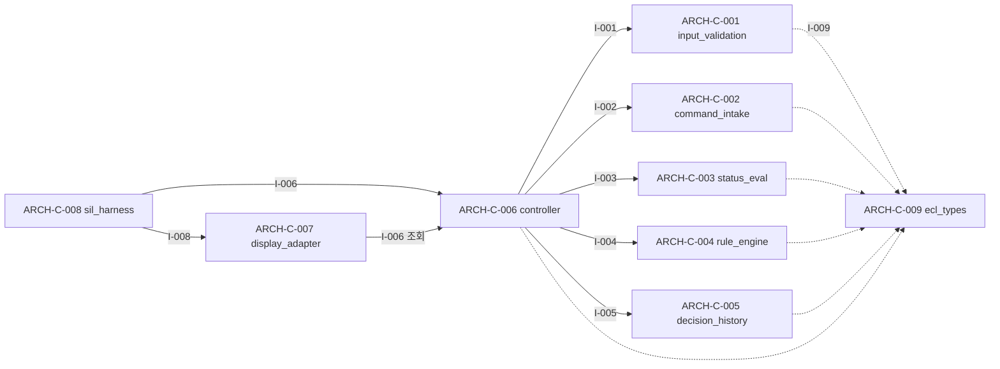
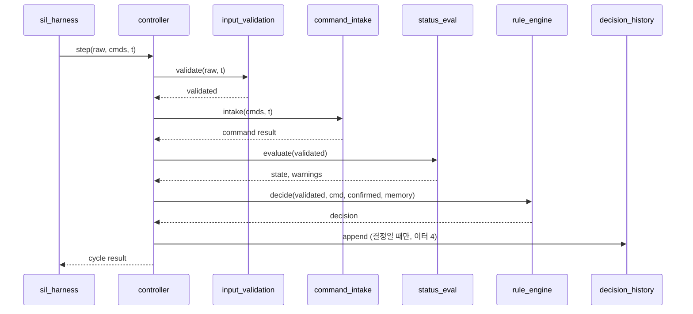

# 소프트웨어 아키텍처 — 전자식 차일드락 제어 SW (SWE.2)

- 문서 ID: SWA-ECL-001, 버전 0.1 (이터레이션 1, OEM 게이트 G2 대상)
- 입력: `docs/requirements/software-requirements.md` v0.2, `docs/safety/safety-requirements.md` v0.2 (재리뷰 미완료, `docs/review/review-waiver.md`)
- 작성 정보: claude-sonnet-5-5, 2026-11-27, 요청자 DongJoonHan. 사용자 리뷰: 미완료. 리뷰: 이터레이션 1~2 면제.
- 구현 언어: C17 (REQ-C-001). 시험은 C++20 (GoogleTest/GMock).

## 1. 설계 개요

입력 묶음 하나와 운전자 명령을 받아 좌/우 출력을 결정하는 **단방향 파이프라인**이다. 각 평가주기에 `controller`가 아래 순서로 컴포넌트를 호출한다. 모든 컴포넌트는 전역 상태가 없고(순수 함수 또는 호출자가 소유한 상태 구조체), 시간은 호출자가 값으로 넘긴다(결정론, REQ-Q-001).



의존은 비순환이다: sil_harness → display_adapter → controller → {input_validation, command_intake, status_eval, rule_engine, decision_history} → ecl_types. 하위 컴포넌트끼리는 서로 호출하지 않는다 (controller 만 조정한다).

## 2. 컴포넌트 (ARCH-C)

| ID | 이름 | 책임 (한 문장) | 인터페이스 | 할당 요구사항 | 구현 이터 |
|---|---|---|---|---|---|
| ARCH-C-001 | input_validation | 원시 입력 묶음의 형식·범위·신선도를 검사해 필드별 유효성이 표시된 검증 입력을 만든다. | ARCH-I-001 | REQ-F-001~005, REQ-S-003, REQ-S-008, REQ-Q-002, REQ-Q-004 | 1 |
| ARCH-C-002 | command_intake | 원시 운전자 명령을 검사하고 평가주기당 1건만 채택하며 거절 이유를 만든다. | ARCH-I-002 | REQ-F-006, 007, 008, 009, 018, 019 | 1 |
| ARCH-C-003 | status_eval | 검증 입력으로부터 상태(FAULT/DEGRADED/OFF/ACTIVE)와 경고코드를 정한다. | ARCH-I-003 | REQ-F-014, REQ-S-009, REQ-S-003 | 1 |
| ARCH-C-004 | rule_engine | 규칙표(1.3절)에 따라 도어별 출력과 이유코드를 결정한다. | ARCH-I-004 | REQ-F-010~012, 017, 020~023, 025~027, 029, 034~037, 028; REQ-S-001, 002, 004~007 | 1(규칙 1·HOLD), 2~3(나머지) |
| ARCH-C-005 | decision_history | 최근 결정 100건을 휘발성 메모리에 순서대로 보관한다. | ARCH-I-005 | REQ-F-030, 031, 032, 038 | 4 |
| ARCH-C-006 | controller | 평가주기마다 컴포넌트를 순서대로 호출하고 확정 출력을 보관·공개한다. | ARCH-I-006 | REQ-F-013, 015, 016, REQ-Q-001, REQ-Q-003 | 1 |
| ARCH-C-007 | display_adapter | 조회 결과를 표시용 문자열(JSON)로 직렬화한다. | ARCH-I-007 | REQ-F-024, REQ-F-033 | 4~5 |
| ARCH-C-008 | sil_harness | JSON 벡터를 읽어 controller 를 재생하고 결과를 JSON으로 출력한다 (Web 시뮬레이터가 읽는다). | ARCH-I-008 | REQ-C-002, REQ-C-003, REQ-Q-001(재생 해시) | 5 |
| ARCH-C-009 | ecl_types | 컴포넌트가 공유하는 데이터 형식(열거형, 구조체)만 정의한다 (동작 없음). | ARCH-I-009 | (전 요구사항 지원), REQ-C-001 | 1 |

전 컴포넌트에 적용되는 제약: REQ-C-001, REQ-C-005, REQ-C-006(프로세스), REQ-C-004. 시스템 경계 밖 항목(REQ-L-001~004)은 3절 "범위 밖 요소"에 둔다.

## 3. 범위 밖 요소 (경계)

도어 래치/구동기 HW, CAN/LIN 드라이버, 구동기 적용 feedback, 센서 성능·진단, 양산 HMI, HIL/실차/ECU, 인증·법규 적합성 (REQ-L-001~004). SW 경계는 `ARCH-I-006`(입력/출력)과 `ARCH-I-008`(PC/SIL 재생)이다.

## 4. 인터페이스 (ARCH-I)

공통 규칙: 모든 함수는 `ecl_status_t` 를 반환하고 (CLAUDE.md implementation 규칙, `ECL_NODISCARD`), 결과는 출력 인자로 돌려준다. 단일 스레드에서 호출한다(스레드 안전성 없음, 설계상 불필요). 메모리는 호출자가 소유하며 컴포넌트는 동적 할당을 하지 않는다. 널 포인터 인자는 `ECL_ERR_NULL_ARG`.

공통 형식(ARCH-I-009, `include/ecl/ecl_types.h`):

```c
typedef enum { ECL_OK = 0, ECL_ERR_NULL_ARG, ECL_ERR_RANGE } ecl_status_t;
typedef struct { int present; double value; } ecl_raw_num_t;   /* present=0 이면 누락 */
typedef struct { int present; int value; } ecl_raw_int_t;      /* enum/불리언의 원시 코드 */
typedef enum { ECL_OUT_RELEASE = 0, ECL_OUT_LOCK = 1 } ecl_output_t;
typedef enum { ECL_STATE_ACTIVE = 0, ECL_STATE_DEGRADED, ECL_STATE_FAULT, ECL_STATE_OFF } ecl_state_t;
/* 원시 입력 묶음, 검증 입력(필드별 valid), 운전자 명령, 이유코드/경고코드 열거(부록 A) */
```

원시 입력의 enum은 정수 코드로 받는다(예: gear 0..3=P,N,D,R, crash 0..2, side 0..2, action 0..1, source 0..3). 범위를 벗어난 코드와 `present=0` 이 INVALID/거절 대상이다. 불리언은 0 또는 1만 유효하다. 영상·음성·식별자 필드는 형식에 존재하지 않는다(REQ-Q-002, REQ-Q-004).

| ID | 제공 → 사용 | 시그니처 (요약) | 사전 조건 | 사후 조건 / 반환 | 오류 | 요구사항 |
|---|---|---|---|---|---|---|
| ARCH-I-001 | input_validation → controller | `ecl_status_t ecl_input_validate(const ecl_raw_snapshot_t* raw, double eval_time_s, ecl_validated_t* out)` | raw, out 비널 | 각 필드가 `valid` 와 값을 가진다. `source_timestamp_s` 가 INVALID이면 모든 필드를 INVALID로 표시한다. `eval_time_s - timestamp > 0.200` 이면 `stale=1`, 모든 필드를 INVALID로 표시한다. | ECL_ERR_NULL_ARG | REQ-F-001~005, S-003, S-008 |
| ARCH-I-002 | command_intake → controller | `ecl_status_t ecl_command_intake(const ecl_raw_command_t* cmds, size_t count, double request_time_s, ecl_command_result_t* out)` | out 비널, count>0 이면 cmds 비널 | 첫 명령이 유효하면 `accepted=1` 과 값, 요청 시각 기록. 나머지는 `extra_rejected` 로 센다. 첫 명령이 무효이면 거절 이유. | ECL_ERR_NULL_ARG | REQ-F-006~009, 018, 019 |
| ARCH-I-003 | status_eval → controller | `ecl_status_t ecl_status_evaluate(const ecl_validated_t* in, ecl_status_result_t* out)` | in, out 비널 | 상태표(1.4절) 우선순서로 상태 하나, 경고코드 집합 | ECL_ERR_NULL_ARG | REQ-F-014, S-009 |
| ARCH-I-004 | rule_engine → controller | `ecl_status_t ecl_rule_decide(const ecl_validated_t* in, const ecl_command_result_t* cmd, const ecl_decision_t* confirmed, ecl_rule_memory_t* memory, ecl_decision_t* out)` | 모든 인자 비널 | 도어별 출력, priority_reason, reason_code, command_note. `memory`(override 상태)는 이 함수만 갱신한다. | ECL_ERR_NULL_ARG | REQ-F-010~012, 017, 020~037, S-001~007 |
| ARCH-I-005 | decision_history → controller | `ecl_history_init`, `ecl_history_append(h, const ecl_decision_record_t*)`, `ecl_history_read(h, size_t index, ecl_decision_record_t*)`, `ecl_history_count(h, size_t*)` | 초기화됨 | 최대 100건, 101번째 입력은 최오래 1건 제거, index 0 이 가장 오래된 것 | ECL_ERR_NULL_ARG, ECL_ERR_RANGE(index 초과) | REQ-F-030, 031, 032, 038 |
| ARCH-I-006 | controller → sil_harness, display_adapter | `ecl_controller_init(ctl)`, `ecl_controller_step(ctl, const ecl_raw_snapshot_t*, const ecl_raw_command_t* cmds, size_t count, double eval_time_s, ecl_cycle_result_t* out)`, `ecl_controller_query(const ctl, ecl_query_result_t*)` | init 후 step | step 후 `out` 에 좌/우 출력, 상태, 이유코드, 경고코드. 내부에 확정 출력과 규칙 메모리를 갱신. 초기 출력 RELEASE. | ECL_ERR_NULL_ARG | REQ-F-013, 015, 016, 024 |
| ARCH-I-007 | display_adapter → sil_harness | `ecl_status_t ecl_display_render(const ecl_query_result_t*, char* buf, size_t cap, size_t* written)` | buf 용량 cap | JSON 문자열 | ECL_ERR_RANGE(용량 부족 = 직렬화 실패, 상위가 HTTP 500 으로 변환) | REQ-F-024, 033 |
| ARCH-I-008 | sil_harness (외부 경계) | 명령행: `ecl_sil <vectors.json> [--repeat N]` → 표준 출력 JSON 결과 + 해시 | 입력 파일 | 평가주기별 공개 결과(부록 B)와 SHA-256 계열 해시 | 비0 종료 코드 | REQ-C-002, C-003, Q-001 |
| ARCH-I-009 | ecl_types | 헤더 `ecl/ecl_types.h` (형식만) | — | — | — | REQ-C-001 |

### 컴포넌트 간 직접 접근 금지 규칙 적용

- 컴포넌트는 서로의 내부 헤더(`src/<컴포넌트>/*.h`)를 포함하지 않는다. 공개 헤더는 `include/ecl/<컴포넌트>.h` 에만 둔다.
- `controller` 외에는 다른 컴포넌트를 호출하지 않는다 (display_adapter 는 `ecl_query_result_t` 데이터만 받는다).
- 컴포넌트 간 전달은 데이터 결합(필요한 구조체 값)만 쓴다. 전역 변수 공유 금지.

## 5. 물리 구조

```
include/ecl/        공개 헤더 (ecl_types.h, input_validation.h, command_intake.h, status_eval.h,
                    rule_engine.h, decision_history.h, controller.h, display_adapter.h)
src/ecl/            input_validation.c, command_intake.c, status_eval.c, rule_engine.c, ...
tools/sil/          sil_harness (ARCH-C-008), 이터레이션 5
test/{tdd,unit,integration,system}/
```

제품 라이브러리 `ecl_core`(정적), 실행 파일 `ecl_sil` 은 이터레이션 5에서 추가한다.

## 6. 동적 거동

평가주기(REQ-F-013, A-01 10 ms) 시퀀스:



- 동시성: 없음(단일 스레드). 시간 의존: 호출자가 주는 `eval_time_s` 와 입력의 timestamp 만 사용하고 시스템 시계·난수는 쓰지 않는다 (REQ-Q-001).
- 자원: 동적 할당 없음, 이력은 고정 배열 100건 (REQ-F-030, 자원 활용성).
- 오류·복구: 입력 오류는 DEGRADED(규칙 미적용 + 확정 출력 유지)로 흡수하며 다음 주기에 입력이 정상이면 자동 복귀한다 (REQ-F-014).
- 성능: 모든 컴포넌트는 입력 크기가 고정이라 O(1)이다. 3 ms 목표(REQ-Q-003)는 이터레이션 1 시험으로 측정한다.

## 7. 설계 결정

| ID | 결정 | 대안 | 선택 이유 / 트레이드오프 |
|---|---|---|---|
| AD-01 | 컴포넌트를 순수 함수 + 호출자 소유 상태로 만든다 | 전역 싱글턴 | 결정론·시험 용이성·MC/DC 시험에 유리. 호출자가 상태를 넘겨야 하는 번거로움 |
| AD-02 | 검증과 규칙 평가를 분리한다 (필드별 `valid` 로 전달) | 검증 실패 시 즉시 중단 | REQ-F-010/011: 유효한 안전 입력은 다른 입력이 깨져도 작동해야 한다 (전역 동결 회피) |
| AD-03 | 원시 입력은 `present` + 정수 코드로 표현 | 문자열/JSON을 코어가 파싱 | 코어를 단순·결정적으로 유지하고 파싱은 하니스에 격리. 코어는 JSON을 모른다 |
| AD-04 | 시간은 호출자가 값으로 주입 | 코어가 시계 호출 | 고정 시계 재생(REQ-Q-001)과 신선도 시험이 쉬워짐 |
| AD-05 | 규칙은 순위 있는 표 + 규칙별 작은 함수 | 하나의 큰 조건식 | CCN ≤ 10, 한 결정 조건 ≤ 6 (CLAUDE.md 4.3) 유지. 함수 수 증가 |
| AD-06 | 상태는 매 주기 입력에서 재계산 (기억 없음, A-08) | 상태기계 | 상태 복귀 규칙이 단순하고 검증 쉬움. override 만 규칙 메모리에 상태를 둠 |
| AD-07 | `ecl_types` 를 별도 수동적 컴포넌트로 둔다 | 각 컴포넌트가 자기 형식을 정의 | 컴포넌트 간 데이터 결합을 명시적 계약으로 고정 |

## 8. 품질·제약 반영

| 요구사항 | 반영 |
|---|---|
| REQ-Q-001 결정론 | AD-01, AD-04. 시스템 시계·난수·전역 상태 없음 |
| REQ-Q-002, Q-004 | 원시 입력 형식(ecl_raw_snapshot_t)에 영상/음성/식별자 필드가 없고 성인 존재는 불리언 코드 필드 하나 |
| REQ-Q-003 | O(1) 컴포넌트, 동적 할당 없음 |
| REQ-C-001 | C17, `extern "C"` 헤더 |
| REQ-C-002, C-003 | ARCH-C-008 (이터레이션 5), JSON 결과는 Web 시뮬레이터가 읽는 뷰어용이며 판단은 C 코어만 한다 |
| REQ-C-005 | 컴포넌트당 함수 소형화(AD-05), 모든 공개 함수 시험 실행 |

## 9. 통합 시험 대상 (SWE.5 준비)

- ARCH-I-001 → controller: 필드별 유효성이 규칙 적용 가능성으로 이어지는 흐름
- ARCH-I-002 → controller → ARCH-I-004: 명령 채택/거절 이유가 reason 으로 전달
- ARCH-I-003 / ARCH-I-004: 상태와 출력의 독립 결정 (sensor_fault 시 FAULT + 출력 유지)
- ARCH-I-006: step → query 응답의 일관성
